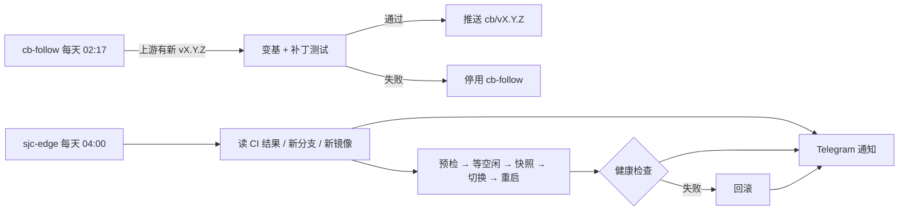

# cb/automation：Hermes WebUI 补丁栈自动跟进与部署

本分支只放自动化，不含 WebUI 代码，是 fork 的默认分支（GitHub 定时任务只在默认分支上运行）。
补丁栈本身在 `cb/vX.Y.Z` 分支，说明见其中的 `PATCHES.md`。



## CI：`.github/workflows/cb-follow.yml`

- 基线是 fork 上最新的 `cb/vX.Y.Z`，目标是上游最新的稳定 tag `vX.Y.Z`（不含 `exp-`），中间版本直接跳过。
- `requirements.txt` 有变化、变基冲突或 `ci/tests.txt` 中的测试失败时不推送，并停用自己；修复后在 Actions 页面重新启用。
- 推送使用仓库 secret `CB_DEPLOY_KEY`（可写 deploy key），因为上游提交可能改动 `.github/workflows`。
- 补丁增删时同步维护 `ci/tests.txt`。

## 服务器：`server/`

hermes 用户的 `hermes-autoupdate.timer` 每天北京时间 04:00 运行 `hermes_autoupdate.py`：

1. 读取 cb-follow 最近一次定时运行；失败、被停用或超过 36 小时没运行都会在通知中提醒。
2. WebUI：远端最新 `cb/vX.Y.Z` 与当前提交不同即升级（含同一 tag 上的补丁修正）。源码有未提交改动时跳过。
3. Agent：Docker Hub 上最新的 `vX.Y.Z` 镜像比当前新即升级；两个 quadlet（`hermes-webui`、`hermes-gateway`）始终写同一个具体版本。
4. 预检：在目标镜像里以无网络容器导入新 WebUI 代码，失败则不动线上。
5. 等 WebUI 与 gateway 都没有运行中的任务，最多 2 小时，仍忙则跳过到第二天。
6. Agent 换版本时，在 `~/.local/state/hermes-autoupdate/agent-snapshot/` 快照 `state.db` 与 `config.yaml`（只保留最近一份）；只升级 WebUI 时不备份。
7. 切换并重启，4 分钟内须通过：服务 active、`/health` 正常且已重启、原本有模型的分组仍有模型；涉及 Agent 时还要求 gateway 运行中、Telegram 已连接、版本号与镜像一致。
8. 失败则切回原分支与原镜像，Agent 换过版本时停服务恢复快照，再检查一次。
9. 结果直接调 Telegram Bot API 发给 `TELEGRAM_ALLOWED_USERS` 的第一个用户；没有新版本且 CI 正常时不发。

手动运行：

```sh
python3 ~/.local/libexec/hermes-autoupdate/hermes_autoupdate.py --dry-run          # 只检查与预检，不改动、不通知
python3 ~/.local/libexec/hermes-autoupdate/hermes_autoupdate.py --drill-rollback   # 有新版本时升级后强制回滚
journalctl --user -u hermes-autoupdate -n 50 --no-pager
```

### 安装 / 更新

以 hermes 用户执行（`XDG_RUNTIME_DIR=/run/user/$(id -u)`）：

```sh
install -D -m 755 server/hermes_autoupdate.py ~/.local/libexec/hermes-autoupdate/hermes_autoupdate.py
install -D -m 644 server/hermes-autoupdate.service server/hermes-autoupdate.timer -t ~/.config/systemd/user/
systemctl --user daemon-reload
systemctl --user enable --now hermes-autoupdate.timer
```

暂停自动升级：`systemctl --user disable --now hermes-autoupdate.timer`。

## 测试

```sh
python3 -m unittest discover -s tests
```
